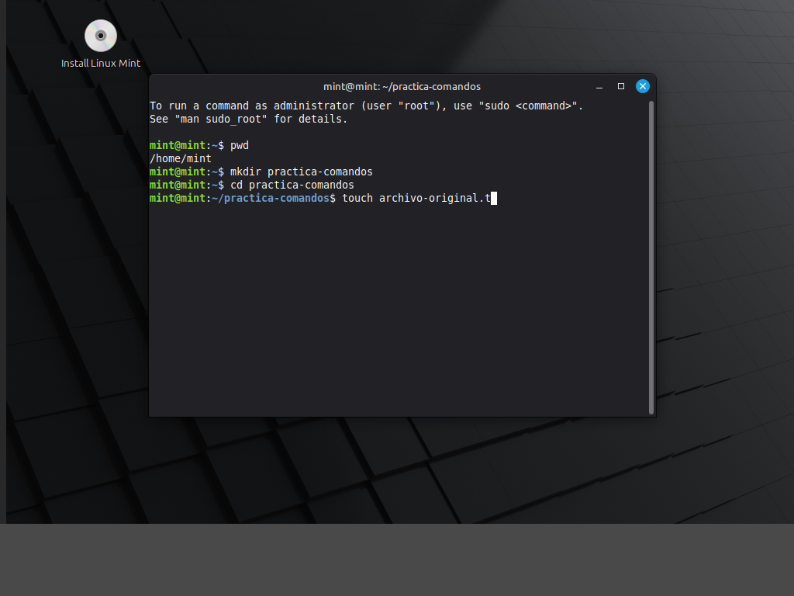
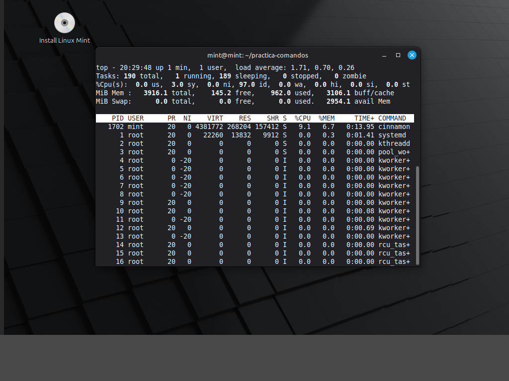
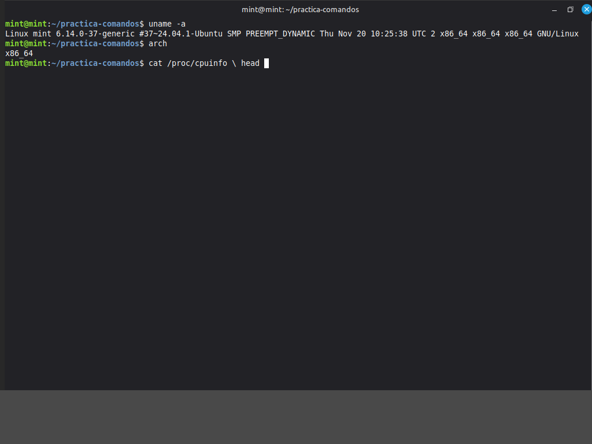
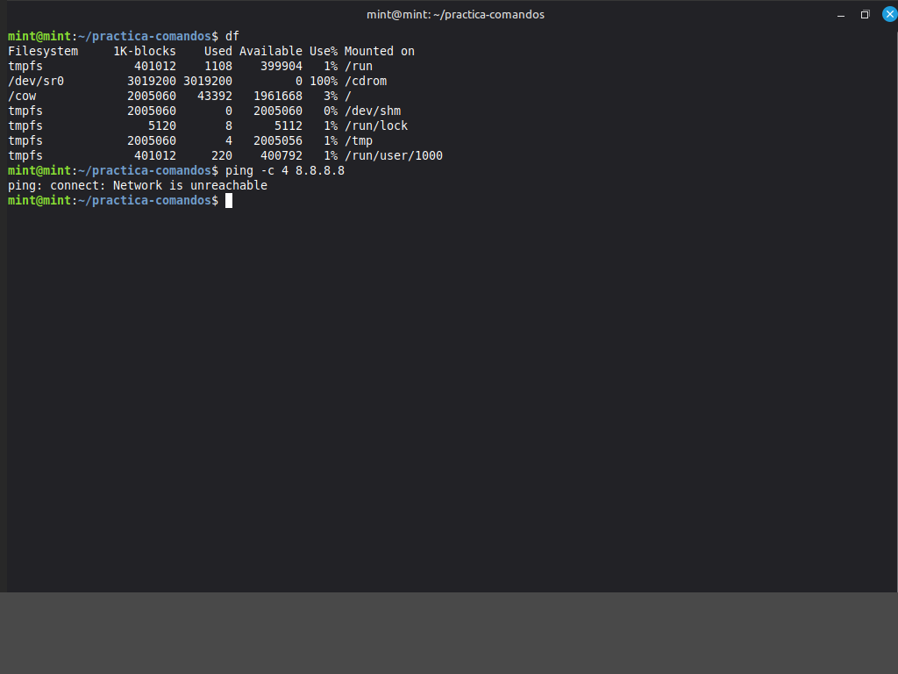

# TP: Comandos Basicos, Procesos y Utilidades en Linux

* **Materia:** Mantenimiento de Software
* **Estudiante:** Francisco S. Sfiligoy Borkoski
* **Fecha de entrega:** 2026

> **Evidencias:** las cuatro capturas se obtuvieron en una terminal real de Linux Mint y muestran el usuario y el equipo en el prompt, los comandos y sus salidas. En la actividad de procesos se ve `top` en ejecucion; tambien se ejecuto `ps` y se salio de `top` con `q`.

---

## 1. Gestion de archivos, directorios y copias

Comandos:

```bash
pwd
mkdir practica_comandos
cd practica_comandos
touch archivo_original.txt
cp archivo_original.txt copia_archivo.txt
ls -al
```



**Explicacion de `ls` y `ls -al`:** `ls` muestra los nombres de los archivos y directorios visibles de la ubicacion actual. `ls -al` tambien muestra los archivos ocultos, porque incluye la opcion `-a`, y presenta el detalle de cada entrada, como permisos, propietario, tamano y fecha, porque incluye `-l`. Tambien indica las entradas especiales `.` y `..`.

## 2. Monitoreo y control de procesos

Comandos:

```bash
ps
top
```



**Diferencia entre `ps` y `top`:** `ps`, sin opciones, presenta una instantanea de los procesos asociados a la terminal actual en el momento en que se ejecuta. `top` es interactivo y actualiza periodicamente la informacion de los procesos y el uso de recursos, lo que permite observar cambios en tiempo real.

**Uso de `kill PID`:** envia una senal al proceso identificado por su PID. Si no se especifica otra senal, `kill` envia `SIGTERM`, que solicita al proceso terminar y le permite cerrar de forma ordenada. Si no responde, un administrador puede evaluar otras senales, como `SIGKILL`; esta termina el proceso sin permitirle hacer limpieza.

## 3. Informacion del sistema y del nucleo

Comandos:

```bash
uname -a
arch
cat /proc/cpuinfo
free
```



**Kernel y memoria:** `uname -a` resume informacion del sistema, como el nombre del nucleo, el nombre del equipo, su version, la arquitectura y el sistema operativo. `free` muestra la memoria RAM y el espacio de intercambio (swap) total, utilizado y disponible, expresados por defecto en kibibytes.

## 4. Diagnostico de red y espacio en disco

Comandos:

```bash
df
ping -c 4 8.8.8.8
```



**Funcionamiento de `ping`:** envia solicitudes de eco ICMP a un destino y espera las respuestas. Sirve para comprobar si el destino resulta alcanzable desde el equipo y para observar los tiempos de respuesta y posibles perdidas de paquetes. Una falta de respuesta por si sola no demuestra que el destino este apagado: una red o un firewall tambien pueden filtrar ICMP. La opcion `-c 4` limita la prueba a cuatro solicitudes.

**Resultado en esta sesion:** se ejecuto `ping -c 4 8.8.8.8`, pero la maquina Linux de prueba en el navegador informo `Network is unreachable`. Por lo tanto, no se pudo confirmar conectividad externa desde ese entorno.
