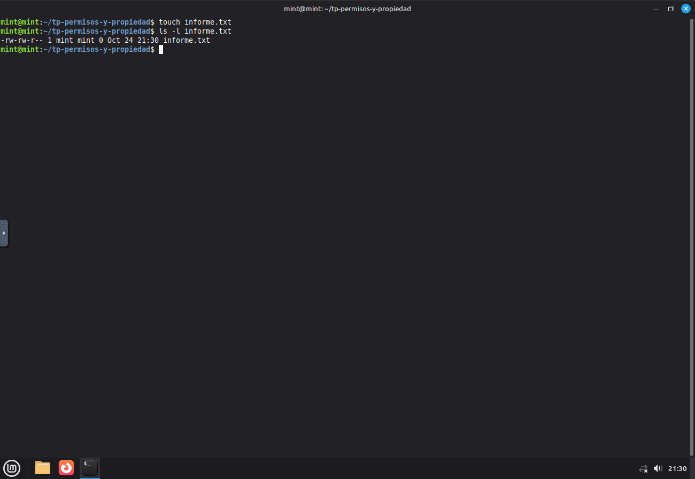
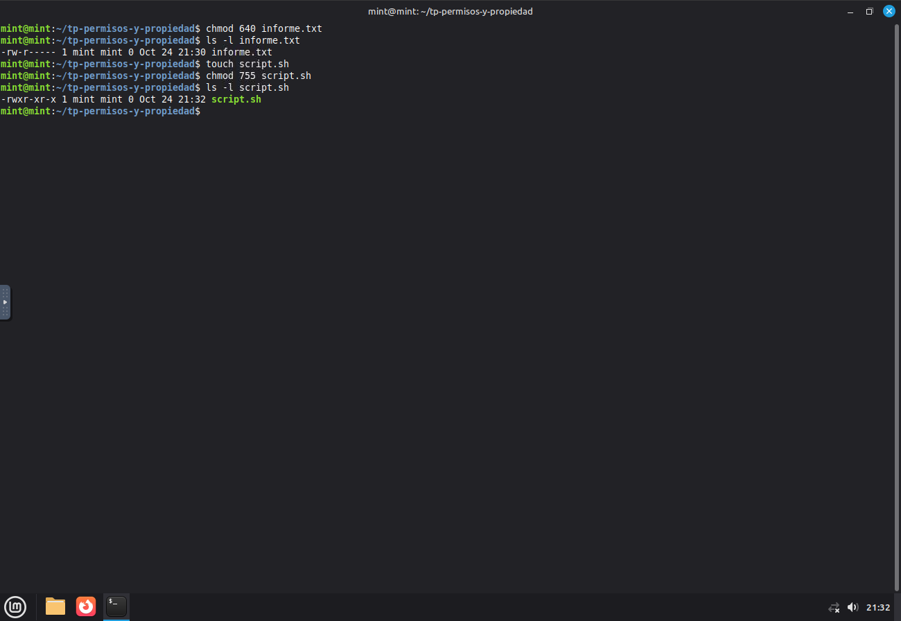
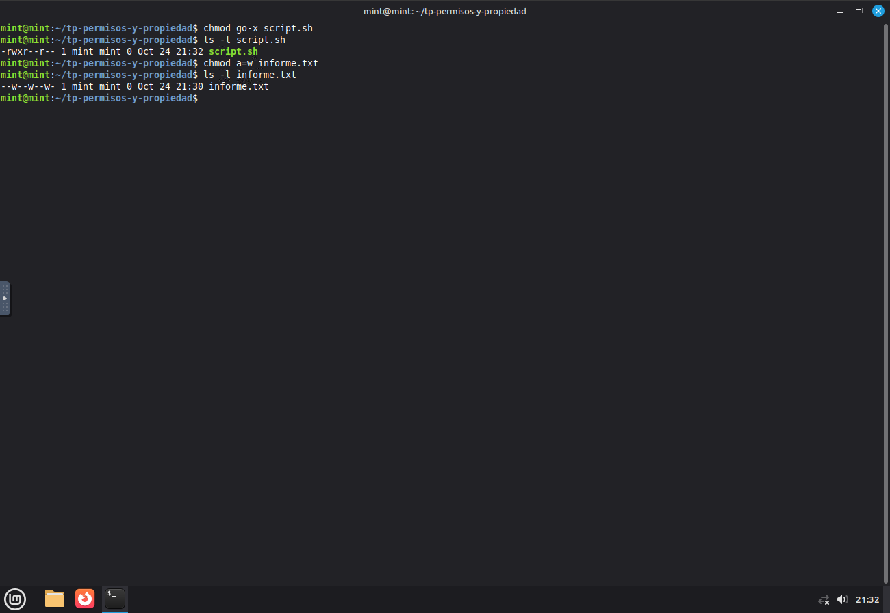
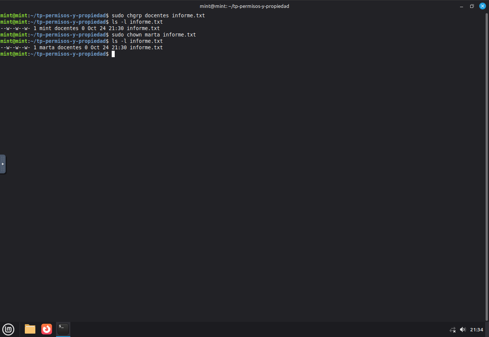
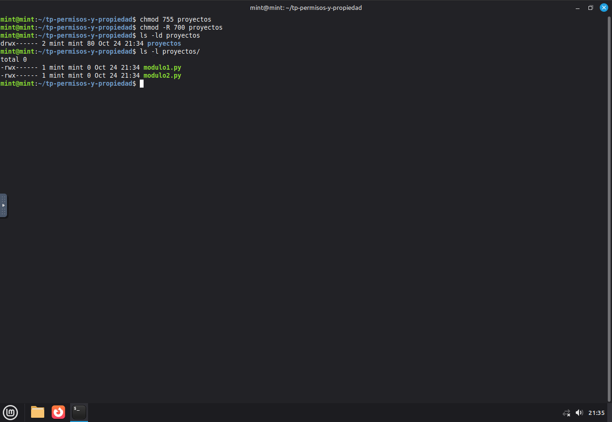

# TP: Permisos de Archivos, Directorios y Propiedad en Linux

* **Materia:** Mantenimiento de Software
* **Estudiante:** Francisco S. Sfiligoy Borkoski
* **Fecha de entrega:** 2026

Las evidencias corresponden a comandos ejecutados en Linux Mint 22.3. Cada
captura muestra la terminal, el prompt y las salidas obtenidas.

---

## 1. Lectura e interpretación de permisos (`ls -l`)

Comandos:

```bash
touch informe.txt
ls -l informe.txt
```



La primera posición indica el tipo de entrada: `-` es un archivo regular, `d`
un directorio y `l` un enlace simbólico. Las nueve posiciones siguientes son
tres grupos de tres permisos:

| Posiciones | Clase | Significado |
| :--- | :--- | :--- |
| 1–3 | Propietario (`u`) | `r` permite leer, `w` modificar y `x` ejecutar el archivo. |
| 4–6 | Grupo (`g`) | Los mismos permisos para los usuarios del grupo asignado. |
| 7–9 | Otros (`o`) | Los mismos permisos para los demás usuarios. |

El guion en una posición de permiso significa que ese permiso no está
concedido. En directorios, `r` permite listar nombres, `w` permite modificar
entradas y `x` permite acceder o atravesar el directorio.

## 2. Asignación de permisos en modo octal (`chmod`)

Comandos:

```bash
chmod 640 informe.txt
ls -l informe.txt
touch script.sh
chmod 755 script.sh
ls -l script.sh
```



Cada dígito suma los valores de lectura (`r=4`), escritura (`w=2`) y ejecución
(`x=1`) para propietario, grupo y otros, en ese orden:

* **640:** propietario `4+2=6` (`rw-`), grupo `4` (`r--`), otros `0` (`---`).
* **755:** propietario `4+2+1=7` (`rwx`), grupo `4+1=5` (`r-x`), otros
  `4+1=5` (`r-x`).

## 3. Asignación de permisos en modo simbólico

Comandos:

```bash
chmod go-x script.sh
ls -l script.sh
chmod a+w informe.txt
ls -l informe.txt
```



La notación simbólica permite apuntar a clases específicas (`u`, `g`, `o` o
`a`, todos) y agregar o quitar permisos (`+` o `-`) sin reemplazar los demás.
Es práctica para un ajuste puntual porque expresa directamente el cambio
deseado. En esta secuencia, `go-x` quita ejecución a grupo y otros, y `a+w`
agrega escritura a todos.

## 4. Cambio de propietario (`chown`) y grupo (`chgrp`)

Para esta prueba se crea el grupo `docentes` y la usuaria `marta`, de modo que
ambos existan en la VM:

```bash
sudo groupadd docentes
sudo useradd -g docentes -d /home/marta -m -s /bin/bash marta
sudo chgrp docentes informe.txt
ls -l informe.txt
sudo chown marta informe.txt
ls -l informe.txt
```



`sudo chown marta informe.txt` cambia el propietario del archivo a `marta`; el
grupo sigue siendo `docentes`. Normalmente solo `root` (o un proceso con la
capacidad privilegiada correspondiente) puede asignar un archivo a otro UID,
por lo que se requiere `sudo` para cambiar el propietario. El cambio de grupo
también se ejecuta con `sudo` en esta práctica.

## 5. Permisos recursivos sobre carpetas (`chmod -R`)

Comandos:

```bash
mkdir proyectos
touch proyectos/modulo1.py proyectos/modulo2.py
chmod -R 700 proyectos
ls -ld proyectos
ls -l proyectos/
```



La opción `-R` aplica el modo indicado al directorio y a todo su contenido.
`700` concede lectura, escritura y ejecución al propietario, y ningún permiso
al grupo ni a otros. En un directorio, `x` significa poder atravesarlo o buscar
una entrada por su nombre; si se quita, no se puede acceder a los elementos del
directorio ni a sus subdirectorios, aunque se conozca su nombre. La lectura del
directorio es un permiso distinto y permite listar sus nombres.
