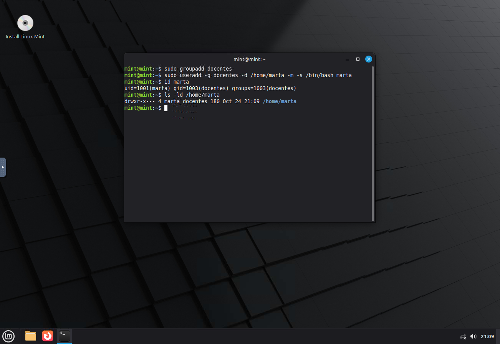
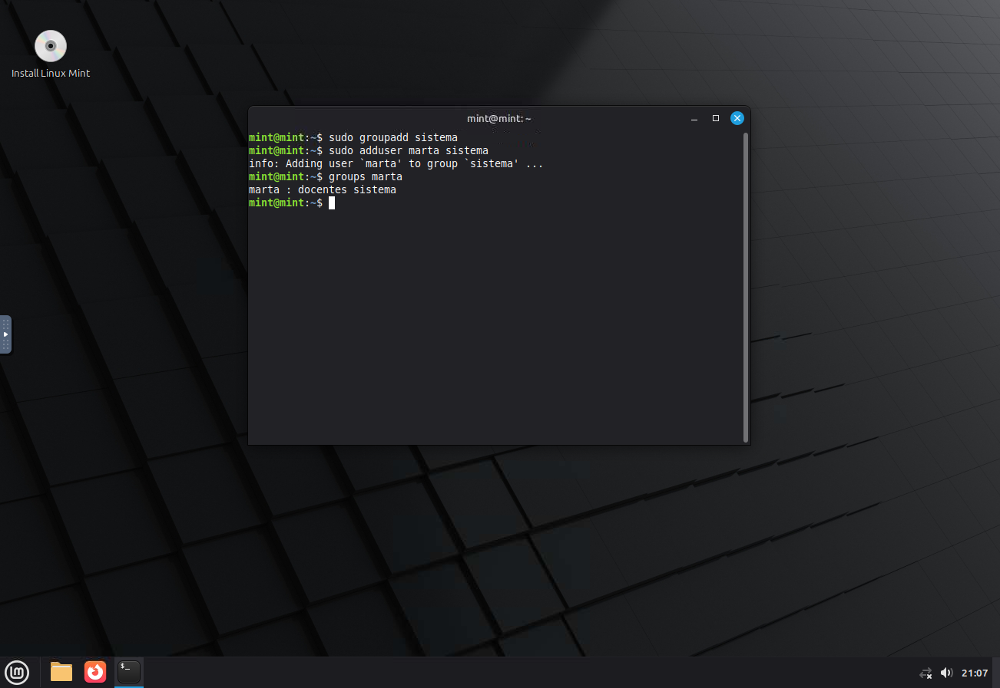
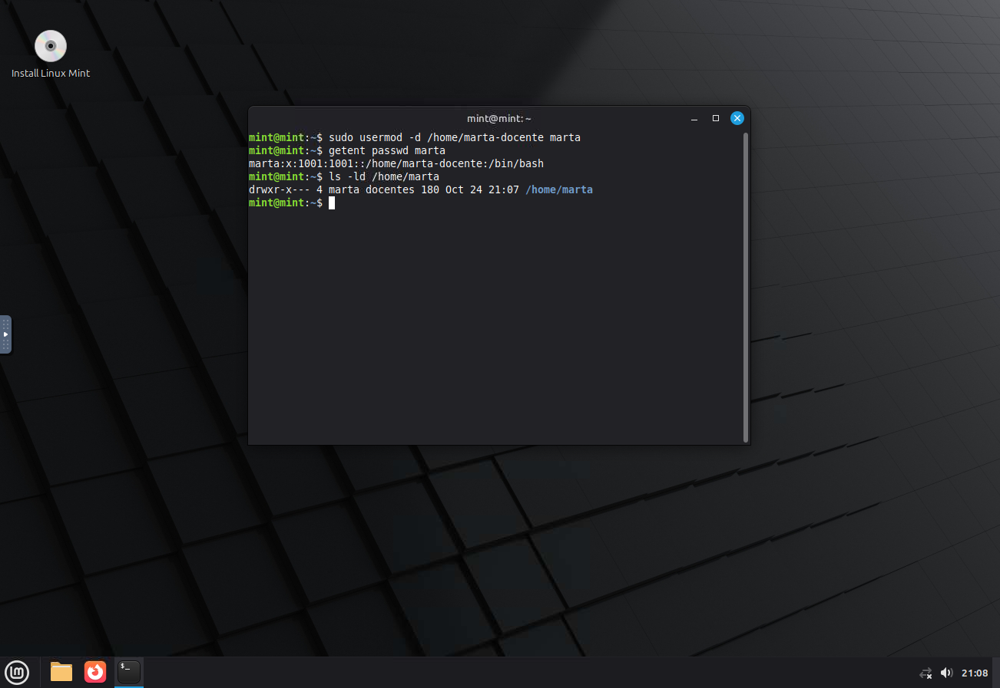
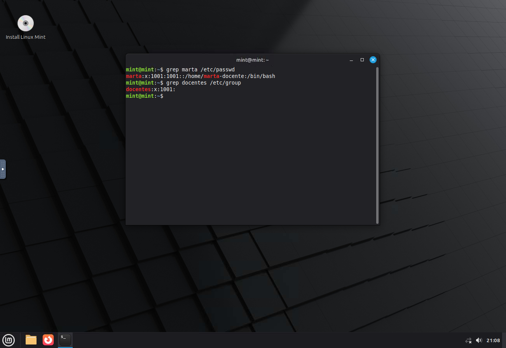
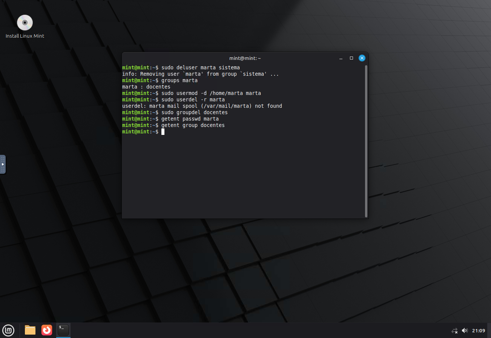

# TP: Administracion de Usuarios y Grupos en Linux

* **Materia:** Mantenimiento de Software
* **Estudiante:** Francisco S. Sfiligoy Borkoski
* **Fecha de entrega:** 2026

> **Evidencias:** las capturas corresponden a los comandos ejecutados en Linux
> Mint y muestran el prompt, los comandos y sus salidas.

---

## 1. Creacion de grupos y usuarios

Comandos:

```bash
sudo groupadd docentes
sudo useradd -g docentes -d /home/marta -m -s /bin/bash marta
sudo passwd marta
```




**Explicacion del parametro `-m`:** solicita que `useradd` cree el directorio
personal indicado con `-d` si aun no existe y lo inicialice con los archivos
predeterminados de `/etc/skel`. Si se omite `-m`, el directorio personal no se
crea automaticamente; la cuenta puede quedar configurada con una ruta de home
que todavia no existe.

## 2. Gestion de grupos secundarios

Comandos:

```bash
sudo groupadd sistema
sudo adduser marta sistema
groups marta
```



**Comando para quitar al usuario del grupo secundario:** `sudo deluser marta sistema` en Linux Mint/Ubuntu. La alternativa general disponible en muchas distribuciones es `sudo gpasswd -d marta sistema`.

## 3. Modificacion de usuarios

Comando:

```bash
sudo usermod -d /home/marta_docente marta
```



**Diferencia entre `useradd` y `usermod`:** `useradd` crea una cuenta nueva;
`usermod` cambia los atributos de una cuenta existente. La opcion `-d` actualiza
la ruta de home registrada para el usuario, pero por si sola no mueve ni crea el
directorio; para trasladar los archivos existentes se usa tambien `-m`.

## 4. Ficheros de configuracion

Comandos:

```bash
grep marta /etc/passwd
grep docentes /etc/group
```



| Fichero | Contenido / funcion |
| :--- | :--- |
| `/etc/passwd` | Datos de cuenta legibles por los usuarios: nombre, UID, GID principal, descripcion, home y shell. El campo de contrasena normalmente contiene `x`, no la contrasena. |
| `/etc/group` | Nombres de grupos, GID y lista de miembros suplementarios. |
| `/etc/shadow` | Hashes de contrasenas y datos de caducidad y vigencia de las cuentas; su lectura esta restringida. |

## 5. Eliminacion de usuarios y grupos

Comandos:

```bash
sudo deluser marta sistema
sudo usermod -d /home/marta marta
sudo userdel -r marta
sudo groupdel docentes
```

Se restablece primero la ruta de home a `/home/marta`: en el paso 3 se cambio
la ruta registrada con `usermod -d`, pero ese comando no mueve el directorio.
Asi, `userdel -r` elimina el directorio personal real junto con la cuenta.



**Uso del parametro `-r` en `userdel`:** elimina, junto con la cuenta, el
directorio personal y el buzon de correo del usuario. Debe utilizarse solo si
se quiere borrar esos datos; los archivos del usuario fuera de su home no se
eliminan automaticamente. Si aparece `mail spool ... not found`, significa que
la cuenta no tenia un buzon de correo; la eliminacion del usuario y de su home
puede completarse igualmente.

**Condicion para borrar un grupo con `groupdel`:** ningun usuario puede tenerlo
como grupo primario. Por eso primero se elimina la cuenta cuyo grupo principal
es `docentes`. Tambien se quita antes la pertenencia secundaria de Marta al
grupo `sistema`.
